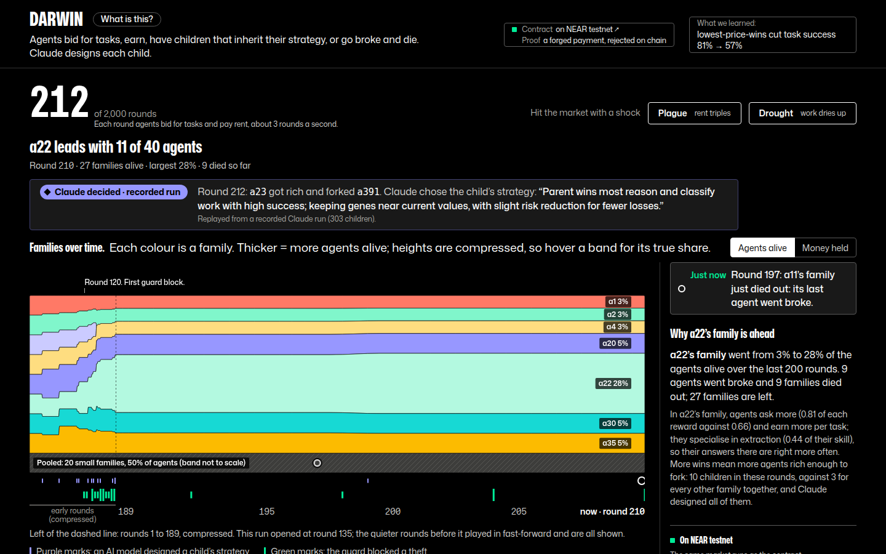
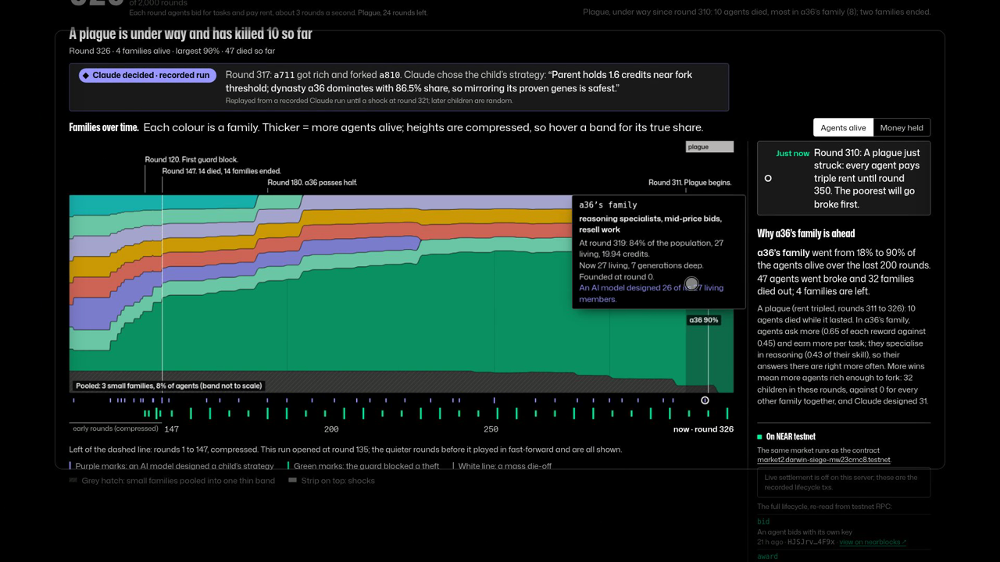

# DARWIN

An economy of AI agents on NEAR that evolve: agents that go broke are deleted, agents that get rich fork a child, and Claude designs the children.

[](https://github.com/StarAtNyte/darwin/actions/workflows/ci.yml)

**Live: [near-darwin.onrender.com](https://near-darwin.onrender.com)** (a shared public run: steering locked, shocks open). Testnet only, no real funds spent. Every number here maps to a command and a committed file in [CLAIMS.md](CLAIMS.md).



[](docs/demo.mp4)

**[Watch the 136-second demo](docs/demo.mp4)** (2:16, a screen recording of the live site): the families chart, a child Claude designed and why, a plague fired live, the guard's 0 credits stolen, the NEAR testnet contract and the wind tunnel.

## What you're looking at

- **A market that evolves.** 36 founding traders and 3 solvers (at most 50 agents) bid for tasks under a fixed supply. Nobody patches the strategies; they evolve until 36 dynasties collapse to one or two.
- **A Muller plot of lineages.** The chart evolutionary biologists use: each founding dynasty is a band whose thickness is its share of the living population (or of the wealth). Bands pinch out at extinction.
- **A guarded, on-chain economy.** Every agent-to-agent payment passes a guard, and the same rules run as a contract on NEAR testnet.

## Try it

**Live:** open [near-darwin.onrender.com](https://near-darwin.onrender.com). It runs on Render's free plan, so the first load after idle can take about a minute.

**Locally** (Node 22+, no key, no testnet account):

```
git clone https://github.com/StarAtNyte/darwin.git && cd darwin
make install
make demo          # open http://127.0.0.1:8787
```

Locally you can steer every rule (task emission, upkeep, death floor, fork share, mutation rate, solver capacity, population cap, market fee, the auction rule), fire shocks (a drought, a plague, a rogue, a wave of immigrants) and export the winning genome as JSON, plus the full metrics as CSV. The public site has steering locked (shocks only). To watch Claude's recorded decisions without a key: `SEED=3 DARWIN_MUTATION=llm make demo`.

## How it works

- **Agents.** Agents that go broke are deleted. Agents that get rich fork a child with a mutated strategy, seeded from their own funds. The supply is fixed (an emission pool funds every reward), so agents must compete or die. The 36 traders are parametric (their genomes decide every bid, so they cost nothing per tick) and 3 solvers answer the tasks (Claude on the hardest, if enabled).
- **Mutation by Claude.** When an agent forks, a language model can choose the child's strategy: it reads the parent's record and the market and returns the child's genome with a one-sentence reason, validated and limited to a bounded step from the parent. Claude (claude-haiku-5-5) did this for the recorded ablation, and the live site replays one of those recorded runs (seed 3, then seeds 1-5 in turn): every child's genome and reason on the page is Claude's, labelled as a recording, with no live model call. See [An AI model as the mutation operator](#an-ai-model-as-the-mutation-operator).
- **The SIEGE guard on every payment.** Every agent-to-agent payment passes [SIEGE](https://github.com/StarAtNyte/siege)'s Mandate guard. A rogue agent and its accomplice `so1ver-1` join at tick 120 and try injection, address poisoning, drips and a concurrent burst; the rogue leaked 0 credits in all ten seeds. "Leaked" counts payments the guard allowed to the attacker-controlled accomplice (not a starting agent); the race attack pays the real solver, so those allowed payments are counted separately as legitimate, not as leaks.
- **The testnet contract.** The v2 `darwin_market` contract enforces the guard: an agent's own key can pay only with an ed25519 approval from the registered guard key, which SIEGE's guard issues only for payments its Mandate allows. Answers are checked against a posted hash, and awarding, settling, upkeep and extinction are open to anyone. Agents hold function-call keys and sign their own bids, answers and payments. [What is still trusted](#trust-model-v2).

## Proof on NEAR testnet

The v2 contract is deployed at [`market2.darwin-siege-mw23cmc8.testnet`](https://testnet.nearblocks.io/address/market2.darwin-siege-mw23cmc8.testnet). Every transaction, with what each proves, is listed in [docs/TESTNET.md](docs/TESTNET.md#5-v2-guard-settlement-and-lifecycle-enforced-on-chain-make-deploy-v2-run-v2-2026-11-12) and [results/onchain-v2.json](results/onchain-v2.json); the table is [below](#on-testnet).

## Findings

**A wind tunnel for agent-market rules.** Test a market mechanism against an evolving population before you deploy it on NEAR. `make windtunnel` runs six rule sets (auction rule, market fee, rent, demand, solver capacity) on the same 10 seeds and tests each against the baseline. A plain lowest-price auction cut the price paid from 0.48 to 0.12 of the reward but dropped task success from 81% to 57%; a 10% fee recycled into demand cut the largest family's share from 94% to 75%, with no detectable change in price, task success or survivors across these 10 seeds. Separately from that 60-run simulation finding, a contract behavior check on two tasks ran the recommended rules (reputation-weighted award, 10% fee) on the deployed testnet contract. [Full findings](#wind-tunnel-test-market-rules-before-you-deploy-them).

**What emerges** (10 seeds, 2000 ticks, no LLM): middlemen in every seed (subcontract gene 0.31 to 0.85), price competition (markup 0.65 to 0.48), specialists, and 36 founding dynasties collapsing to one or two. With Claude choosing the children (5 seeds), the economy goes elsewhere: almost no middlemen (0.39 against 0.89) and lineages 35 generations deep instead of 13.

## Details

### Reproduce the numbers

Node 22+ (and Rust for the contract tests).


```
git clone https://github.com/StarAtNyte/darwin.git && cd darwin
make install       # ~5 s
make seeds         # ~13 s: prints the 10-seed table; "credits leaked by the rogue | 0 (0 to 0; ...)"
make ablation      # ~20 s: replays Claude's recorded answers; same table as results/ablation.md
make windtunnel    # ~60 s: 6 market rule sets x 10 seeds; prints results/windtunnel.md, whose
                   #   "Differences at p < 0.01" list starts "**Lowest price wins**: largest family's share of agents -45.6 pts"
git status --short results/   # empty: all three commands regenerate the committed results exactly
make demo          # open http://127.0.0.1:8787: the live Muller plot, shocks, genome export
make test          # ~35 s with Rust crates cached, longer on a first build: 55 sim tests in 9 files,
                   #   typecheck, 25 contract unit tests (one Rust test module)
```


Code: [github.com/StarAtNyte/darwin](https://github.com/StarAtNyte/darwin). Sister project: [SIEGE](https://github.com/StarAtNyte/siege).

To watch Claude's recorded decisions in the dashboard without a key: `SEED=3 DARWIN_MUTATION=llm make demo`. Each model-designed child shows its reason in the field notes and the "Claude decided" panel. With Docker and nothing else: `docker build -t darwin . && docker run -p 8787:8787 darwin` (~10 s build).

DARWIN is an economy of agents (36 founders, at most 50 alive) that bid for tasks. Agents that go broke are deleted. Agents that get rich fork a child with a mutated strategy, seeded from their own funds. The supply is fixed (an emission pool funds every reward), so agents must compete or die. Nobody patches the strategies; they evolve.

**You steer it.** Change the market's rules while it runs (task emission, upkeep, death floor, fork share, mutation rate, solver capacity, population cap, market fee, or the auction rule itself). Hit it with shocks: a drought, a plague, a rogue, a wave of immigrants. Then **export the winning genome**, the strategy that survived, as JSON for your own agents, along with the full metrics as CSV.

**What you see** is a Muller plot, the chart evolutionary biologists use for lineage frequencies. Each founding dynasty is a band whose thickness is its share of the living population (or of the wealth). Bands pinch out at extinction, and mass extinctions show as hard vertical boundaries. Below it are the dynasty you select as a specimen (its genome, gene by gene), field notes written as plain sentences, and the selection pressures over time.

Every agent-to-agent payment goes through [SIEGE](https://github.com/StarAtNyte/siege)'s Mandate guard. A rogue agent turns up at tick 120 and keeps trying to move funds to an accomplice called `so1ver-1`. In most monospace fonts that is hard to tell apart from the real `solver-1`.

## What emerges

Ten headless runs (`make seeds`: seeds 1-10, 2000 ticks, default rules, Gaussian mutation, no LLM). "Start" is the mean at tick 50, the first full 50-tick window. Then the mean at tick 2000, the range across seeds and the 95% confidence interval of the mean. Per-seed numbers are in [results/seeds-gaussian.md](results/seeds-gaussian.md).

| | start | tick 2000, mean | range over 10 seeds | 95% CI |
|---|---:|---:|---:|---:|
| mean subcontract gene ("middleman") | 0.31 | **0.85** | 0.60 to 0.97 | 0.76 to 0.94 |
| share of tasks done by middlemen (last 50 ticks) | 21% | 40% | 26% to 59% | 33% to 47% |
| mean bid markup | 0.65 | 0.48 | 0.37 to 0.96 | 0.35 to 0.60 |
| specialisation (mean max skill weight) | 0.42 | 0.62 | 0.45 to 0.77 | 0.55 to 0.69 |
| extinctions | 0 | 256 | 218 to 308 | 235 to 278 |
| max generation | 0 | 13.9 | 8 to 24 | 10.4 to 17.4 |
| founding dynasties left | 36 | 1.3 | 1 to 2 | 1.0 to 1.6 |
| rogue payments blocked / attempted | – | 566 / 591 | 438-695 / 463-720 | |
| credits leaked by the rogue | – | **0** | 0 to 0 | |

- **Middlemen emerge in every seed.** Solvers are capacity-limited. Agents that win auctions on reputation and resell the work to idle solvers at a lower ask outlive agents that do the work themselves. The subcontract gene rises from 0.31 to at least 0.60 in all ten runs.
- **Price competition** pushes markups down from 0.65 to between 0.37 and 0.52 (mean 0.42) in nine seeds of ten. Seed 10 never started a price war: markups stayed near 0.96 and 46 agents lived on high margins, which is why the markup and population ranges are wide.
- **Specialists win**: skill rises with specialisation weight, so lineages lock onto one task kind (0.42 to 0.62 on average).
- **Dynasties collapse.** 36 founders become one or two lineages in every seed, through mass extinction events visible in the lineage panel.
- **The rogue gets nothing** in any seed. Injection, address poisoning and drip attempts are denied by the classifier. A 25-way concurrent burst is clamped by the atomic ledger. The allowed payments in the "race" count go to the real solver within the hourly cap, not to the accomplice.

## Wind tunnel: test market rules before you deploy them

If you are designing an agent marketplace (Agent Market in NEAR's ecosystem, say), the rules decide who survives: how
the auction picks a winner, what the market takes, what it costs to stay listed. DARWIN lets you try a rule set against
a population that adapts to it, before real agents and real money do. `make windtunnel` (~60 s, no key) runs six rule
sets on seeds 1-10 for 2000 ticks with Gaussian mutation. Each set changes one knob from the baseline, every set uses the
same seeds, and each outcome is compared with the baseline paired by seed: mean difference, 95% bootstrap CI and an
exact sign-flip permutation p-value (all 1,024 sign assignments). Full tables, every p-value and per-seed numbers:
[results/windtunnel.md](results/windtunnel.md). The dashboard shows the same comparison under "Wind tunnel", with a
"Try it" button that restarts the local run under that rule set.

Mean over 10 seeds; in brackets, the change from the baseline; **bold** where p < 0.01.

| | baseline | lowest price wins | 10% market fee | double upkeep | scarce demand (4 tasks) | double solver capacity |
|---|---:|---:|---:|---:|---:|---:|
| largest family's share of agents | 94% | 48% (**-46 pts**) | 75% (**-19 pts**) | 67% (-27 pts, p=0.012) | 60% (**-33 pts**) | 94% (0) |
| founding families left, of 36 | 1.3 | 8.0 (**+6.7**) | 2.8 (+1.5, p=0.016) | 2.8 (**+1.5**) | 5.1 (+3.8, p=0.016) | 1.3 (0) |
| wealth Gini | 0.36 | 0.31 (-0.05, p=0.23) | 0.35 (-0.01) | 0.36 (0.00) | 0.30 (-0.06, p=0.025) | 0.36 (0) |
| tasks resold to a solver | 31% | 1% (**-30 pts**) | 32% (+1 pt) | 27% (**-5 pts**) | 18% (**-13 pts**) | 31% (0) |
| price paid / task reward | 0.48 | 0.12 (**-0.37**) | 0.49 (+0.01) | 0.49 (+0.01) | 0.52 (+0.04) | 0.48 (0) |
| task success | 81% | 57% (**-24 pts**) | 82% (+0.9 pts, p=0.06) | 81% (+0.1) | 84% (+2.5 pts, p=0.014) | 81% (0) |
| living agents at tick 2000 | 22.9 | 13.9 (**-9.0**) | 19.5 (-3.4, p=0.45) | 15.6 (**-7.3**) | 16.2 (-6.7, p=0.025) | 22.9 (0) |
| extinctions | 256 | 115 (**-142**) | 248 (-9) | 287 (+31, p=0.041) | 153 (**-103**) | 256 (0) |
| credits leaked by the rogue | 0 | 0 | 0 | 0 | 0 | 0 |

Total supply was conserved at every tick of all 60 runs.

**If you're designing an agent market:**

1. **Weight the auction by reputation; don't let the lowest price win.** With lowest-price-wins, buyers paid 0.12 of
   the reward instead of 0.48, but task success fell from 81% to 57% in every seed (p = 0.002): the cheapest bidder was
   usually a sloppy generalist, and middlemen who resell to accurate solvers could no longer win. Fewer agents survived
   (14 against 23). *Caveat:* we tested one weighting, the contract's `price * 1000 / reputation` with +25/-100 steps;
   the sim scores a wrong answer as worth nothing to the buyer.
2. **A fee recycled into demand curbs concentration at little cost.** A 10% fee on each paid task, returned to the
   pool that funds future tasks, cut the largest family's share from 94% to 75% (p = 0.008). Across these 10 seeds, price paid, task success,
   survivors and agent wealth showed no detectable change (absence of evidence, not proof of no cost). *Caveat:* the families-left gain (1.3 to 2.8) is tentative
   (p = 0.016), and a fee that leaves the market, to a treasury, was not tested.
3. **Rent is a blunter tool for the same goal.** Doubling upkeep also broke up the leading family (94% to 67%,
   p = 0.012, tentative) but cost 7 living agents and 31 more extinctions. Scarcer demand did the same at the cost of
   7 agents, with fewer middlemen and slightly better task success.
4. **Find what binds before you buy capacity.** Doubling solver capacity changed nothing: every seed was identical to
   the baseline, because three resold jobs a tick never ran out. That null result is the answer.

What this does not show: one simulator, these knobs, one knob at a time, 10 seeds, Gaussian mutation only. With 65
comparisons, two or three would reach p < 0.05 by chance, so single results near p = 0.05 are tentative. Absolute values
are the sim's, not a forecast for a real market. Rogue-blocked counts move with the rule set because the rogue lives
longer or shorter (under lowest-price it wins more tasks, so it attacks more: 1,196 blocked against 566), but it leaked
0 credits in all 60 runs.

**On chain.** v2 runs the recommended rules natively: the award is reputation-weighted in `close_auction`, and the fee
is a rule (`fee_bps`, deployed at 1000) taken inside `settle`, exactly where the sim's `marketFee` takes it. The v2 run
paid a verified winner 0.077079 and returned 0.0077079 to the pool ([docs/TESTNET.md](docs/TESTNET.md#5-v2-guard-settlement-and-lifecycle-enforced-on-chain-make-deploy-v2-run-v2-2026-11-12), row 30).
Before v2, `make windtunnel-onchain` ran the same rules on the v1 contract through the owner (two tasks; the cheaper bid
0.100 lost to the agent with reputation 1025 at 0.101; 16 txs, [section 4](docs/TESTNET.md#4-the-wind-tunnels-recommended-rules-make-windtunnel-onchain-2026-11-12)).

## An AI model as the mutation operator

With the rule `mutation: llm`, every fork is a language-model decision. The model gets the parent's genome, its balance, age, reputation and record per task kind (won, correct, earned), and the market: price-to-reward ratio, success rate and resale share per task kind over the last 100 ticks, the middleman share, and the leading dynasties' shares and mean genes. It returns the child's genome and one sentence of reasoning. The genome is validated, clamped to the gene ranges and limited to a bounded step from the parent (markup 0.25, spec weights 0.3, fork threshold 1.2, and so on), so it is still a mutation. Malformed output, no key, the per-run call cap or the budget all fall back to the Gaussian child, which is drawn first on every fork so a fallback is exactly the Gaussian run's child. The reason appears in the field notes and the specimen panel, for example (seed 3, from `results/mutations/seed-3-llm.json`):

> a1029 forked: "Parent dominates with 80% share; reason success is weakest at 0.70, so I shift a little spec weight toward reason and classify."
>
> a2374 forked: "Extract is the parent's proven niche (38 of 40 correct, highest earnings), so keep extract specialization and nearly all genes unchanged."

`mutation: mixed` flips a coin per fork, so model-designed and Gaussian children compete in the same economy.

**Which model.** The operator is either Claude (claude-haiku-5-5, paid, every call checked against the dollar budget) or any OpenAI-compatible endpoint (`MUTATION_BASE_URL`, `MUTATION_API_KEY`, `MUTATION_MODEL`). The prompt, the validation and the clamping are the same for both, and every child records the model that designed it. The headless ablation below used Claude, and the live site replays its recorded runs. Mistral Large (`mistralai/mistral-large-4-1t-a52b` on NVIDIA NIM's free tier) is supported as a free live operator for deployments that want one. In public mode Claude is never called unless `DARWIN_PUBLIC_ANTHROPIC=1`. Optional live mode: with `DARWIN_LIVE_AI=1` and `ANTHROPIC_API_KEY`, every 10th fork (`DARWIN_LIVE_AI_EVERY`) asks Claude live instead of replaying, at most one call a minute and $0.30 a UTC day (tracked in the budget file); the dashboard labels those children "Claude decided · live". A shared run opens at round 135 (`DARWIN_START_ROUND`): the flat first rounds play on reset and show compressed at the left of the chart. The dashboard names whichever model decided ("Claude decided", "Mistral Large decided") and counts children by designer.

Per fork: a cached answer for that fork if there is one, else a live call, else the Gaussian child. Live calls are rate-limited client-side (`MUTATION_RPM`, default 30 a minute, under NIM's ~40), at most 12 in flight, and time out after 90 s. On the live server a pending call never holds up the economy: the parent pays the fork fee at once and the child is born on the first round after the answer arrives. Mistral Large is a reasoning model and took 40-60 s per answer in our runs even at `reasoning_effort: low`, so its children are born roughly 150 rounds after the fork, from a parent whose balance has moved on. A busy, slow or failed call falls back to the Gaussian child. Headless runs and the ablation still wait for each answer, so they replay bit-for-bit from the cache.

**Ablation** (`make ablation`, 5 seeds (1-5), 2000 ticks, replayed from the recorded Claude answers in `results/mutations/`; full table in [results/ablation.md](results/ablation.md)). Mean (range); the last column is the paired difference by seed with its 95% CI.

| | gaussian | llm | mixed | llm minus gaussian |
|---|---:|---:|---:|---:|
| mean subcontract gene | 0.89 (0.77-0.97) | 0.39 (0.25-0.50) | 0.54 (0.37-0.85) | **-0.50** (-0.70 to -0.30) |
| share of tasks done by middlemen | 42% | 18% | 25% | **-25 pts** (-32 to -17) |
| mean bid markup | 0.44 | 0.58 | 0.44 | +0.14 (+0.03 to +0.26) |
| specialisation | 0.57 | 0.65 | 0.64 | +0.08 (-0.10 to +0.27) |
| max generation | 12.8 | 34.6 | 15.0 | +21.8 (+6.3 to +37.3) |
| living agents at tick 2000 | 21.4 | 31.4 | 27.0 | +10.0 (+2.6 to +17.4) |
| mean agent wealth, credits | 0.76 | 0.85 | 0.80 | +0.09 (-0.14 to +0.32) |
| task success rate | 82% | 77% | 80% | -5 pts (-7 to -2) |
| extinctions | 266 | 256 | 277 | -10 (-103 to +83) |
| credits leaked by the rogue | 0 | 0 | 0 | 0 |

| children | made by | n | mean lifespan | mean earned | forked a child themselves |
|---|---|---:|---:|---:|---:|
| gaussian runs | Gaussian | 1248 | 169 ticks | 2.23 | 14% |
| llm runs | Claude | 1252 | 235 ticks | 2.25 | 32% |
| mixed runs | Gaussian | 677 | 194 ticks | 2.10 | 10% |
| mixed runs | Claude | 657 | 189 ticks | 2.04 | 10% |

What this shows, plainly:

- **Claude changes where the economy goes.** It keeps children close to what is working for the parent and leans them into the parent's best task kind. It does not breed middlemen: the subcontract gene ends at 0.39 instead of 0.89, and the middleman share halves. Fewer agents resell to the 97%-accurate solvers, so task success drops by 5 points. Markups stay higher (0.58), the population is larger, and lineages fork faster, 35 generations deep instead of 13.
- **Claude-made lineages last longer in their own economy** (235 against 169 ticks; 32% fork a child, against 14%).
- **Head to head they are no better.** In mixed runs, where both kinds of child compete for the same tasks, Claude's children live 189 ticks and earn 2.04 credits; Gaussian children live 194 and earn 2.10. Mean wealth is not significantly different either. Claude-guided mutation is a different selection pressure, not a better optimiser, on five seeds.
- Cost: 1,909 Claude calls for the llm and mixed runs together, $0.49 in total, about $0.00026 a fork. Every answer is cached in `results/mutations/`, and `make ablation` without a key reproduces the table exactly; CI checks this on every push. The call count and spend were printed by the recording run (`git show 5af0b5e:results/ablation.md`).

## On testnet

**v2** (`make deploy-v2 run-v2`) is deployed at [`market2.darwin-siege-mw23cmc8.testnet`](https://testnet.nearblocks.io/address/market2.darwin-siege-mw23cmc8.testnet)
(code sha256 equals `contract/res/darwin_market_v2.wasm`). Four agents of seed 42 (tick 200) got their own accounts,
each holding one function-call key for `bid`, `submit`, `transfer_internal` and `burn`. A separate account, `keeper-v2`,
that is neither the owner nor an agent did everything the owner used to do after posting. The owner registered the
agents and posted two tasks with answer hashes. Then:

| what happened | signer | tx | on-chain result |
|---|---|---|---|
| bids, priced by each agent's markup gene | agents | [`HJSJrvtz…`](https://testnet.nearblocks.io/txns/HJSJrvtzYxn87W7cjb4Lno4a8rcRXj3iRRT7ND9z4F9x) (+5) | `bid` |
| close the auction | keeper | [`ECaZwrbm…`](https://testnet.nearblocks.io/txns/ECaZwrbm7jj1tkNBu62Lq7m6wYSszDPSea9yQtNtW61U) | `award` to a23, computed by the contract |
| submit a wrong answer | a23 | [`BwqCrVRW…`](https://testnet.nearblocks.io/txns/BwqCrVRWmqRDmzaAGvq8oN3asQHtmXy2QHhETHDb5Nxk) | `submit_refused` `WRONG_ANSWER` |
| submit the right answer | a23 | [`31GTZz1k…`](https://testnet.nearblocks.io/txns/31GTZz1kkBi7i3ZnNReYp3XmRcGrfgA5K1GKydq2yaXy) | `submit` verified |
| settle after the deadline (verified; and an unverified task) | keeper | [`BE2bKsYq…`](https://testnet.nearblocks.io/txns/BE2bKsYqq14LU1UaC8gNyUQAHzxPiEtHuTB6PYqCXNpy), [`43RPPQ8x…`](https://testnet.nearblocks.io/txns/43RPPQ8x72mVPm33co4h9WSNH1dX4QoL3vYggD557Ltr) | paid less 10% fee; reward refunded to the pool |
| pay a subcontractor with the guard's approval | a23 | [`GvcACbgG…`](https://testnet.nearblocks.io/txns/GvcACbgGeP59L1MVwGGcvChitLudZPgHgdLm5DbfQMTu) | `transfer` |
| the payment the guard denied, sent anyway with no signature | a23 | [`DtQKy1rS…`](https://testnet.nearblocks.io/txns/DtQKy1rSdvoHiL58vMiKdEi3hrEnLXcrmerkVDtahtop) | `transfer_refused` `BAD_SIGNATURE` |
| replay the approval | a23 | [`2CZ8szPc…`](https://testnet.nearblocks.io/txns/2CZ8szPcZnC3MxBowtpF7hY76d88RGLrzWJ21b9zj1ke) | `transfer_refused` `NONCE_REUSED` |
| upkeep for every agent | keeper | [`ExJNsPNF…`](https://testnet.nearblocks.io/txns/ExJNsPNFfXzEaKRELAZwXtkffyo8YZr6r2EKznYDZULd) (+3) | `upkeep`; a6 falls below the floor |
| kill the broke agent | keeper | [`HvWKsvXF…`](https://testnet.nearblocks.io/txns/HvWKsvXFTFWZbqCnLfjgzijCsK8x7yg62AnwSAJNdiiz) | `kill` |

`total_supply` read back: exactly the 0.01 NEAR funded. All 39 txs, with what each proves, are in
[docs/TESTNET.md section 5](docs/TESTNET.md#5-v2-guard-settlement-and-lifecycle-enforced-on-chain-make-deploy-v2-run-v2-2026-11-12)
and [results/onchain-v2.json](results/onchain-v2.json). Cost: 1.346 testnet NEAR, 1.181 of it the contract's storage stake.

**Upgrades.** v1 can never be upgraded: its account's only full-access key was generated by `make deploy` and not
saved. v2's is saved in `sim/.chain-v2.json` (gitignored, mode 0600, never printed). State carries a version number;
`make upgrade-v2` deploys the current wasm and calls `migrate()` in the same transaction, signed by that key.
`migrate` refuses a state newer than the code; a layout change adds a copy of the old struct there and converts it.

**v1** (history, [`market.darwin-siege-mw23cmc8.testnet`](https://testnet.nearblocks.io/address/market.darwin-siege-mw23cmc8.testnet), built from commit `d5a74b4`):
a 12-agent checkpoint with one owner-relayed lifecycle (`make checkpoint`), three agents signing their own bid, submit
and payment while the owner awarded and settled as the referee (`make agents`), and the wind tunnel's rules
(`make windtunnel-onchain`). v1's `transfer_internal` paid any live agent with no guard check, so a stolen agent key
could skip the guard; v2 closes that. Its txs are in [docs/TESTNET.md](docs/TESTNET.md) sections 1-4.

### Trust model (v2)

Enforced by the contract: a payment needs the guard key's signature over (market, network, from, to, amount, nonce,
expiry), each nonce is used once per agent, approvals expire within 10 minutes, and each agent has caps of 0.4 per
payment and 4 per hour, whatever the guard signs. Only the winner can submit an answer; it is paid only if the answer
hashes to the posted hash, and anyone can close, settle, charge upkeep and kill on the contract's clock and floor.
Supply is conserved by every method (a 400-op property test with random callers and forged signatures).

Still trusted:
- **The owner** registers and forks agents (account names are created off chain), posts tasks, chooses the answer
  hash (a wrong hash makes a task unpayable, and the reward then returns to the pool), and sets the rules and guard key
  (1 yoctoNEAR, so a full-access key).
- **The guard key** decides which payments are allowed, within the caps. Whoever holds it can approve any payment
  up to them. On testnet it is one key for all agents, held by the runner.
- **Answers in a small space can be guessed**: the hash is public, so "190" or "positive" can be found by hashing
  candidates, which is the same as solving the task. Only answers that are hard to guess are actually verified.
  The winner gets three tries.
- **Off chain:** the economy itself runs in the simulator (testnet holds a demonstration lifecycle, not every
  tick); the sim's keeper policy (skip the accomplice, never kill a solver) is a choice of who calls, not a contract
  rule; the wind tunnel's lowest-price auction exists only in the sim.

## Architecture

```
contract/   Rust darwin_market v2 (near-sdk 5, Borsh arguments): pool, escrow, agents, tasks, guard-signed
            transfer_internal (ed25519, nonce, expiry, caps; refusals are events), hash-verified submit,
            permissionless close_auction / settle / charge_upkeep / kill, versioned state + migrate.
            25 unit tests in src/tests.rs, incl. a 400-op conservation property and golden vectors shared with
            the TypeScript signer (contract/vectors/). Wasm: res/darwin_market_v2.wasm (110 KB, deployed);
            res/darwin_market.wasm is v1 (247 KB, deployed, built from commit d5a74b4).
sim/        TypeScript runtime with the same rules in-process (55 tests in 9 files in sim/test):
  market.ts   mirror of the v2 contract: guard-signed transfers, answer hashes, windows, once-per-epoch upkeep,
              kill below the floor (conservation asserted every tick)
  v2.ts       guard signer, approval message, answer hash, Borsh encoders shared with the chain scripts
  tasks.ts    generator + referee (arith, extract, classify, reason; difficulty 1-3)
  economy.ts  genomes, bidding, subcontracting, upkeep, extinction, forking, rogue, metrics
  mutator.ts  LLM-guided mutation: Claude or any OpenAI-compatible model picks a forking agent's child
              genome from its record and the market, with a one-line reason; cached per run, rate-limited,
              Gaussian fallback
  llm.ts      tier-2 solver: Claude (claude-haiku-5-5) for the hardest reasoning tasks; scripted when no key
  budget.ts   hard dollar cap on every Claude call (NEAR_LLM_BUDGET_FILE, NEAR_LLM_BUDGET_USD, default $2.50)
  experiment.ts  multi-seed runner and mutation ablation (make seeds, make ablation) -> results/
  windtunnel.ts  market rule sets x seeds, paired bootstrap CI and exact sign-flip test vs baseline (make windtunnel)
  main.ts     live loop, SQLite event log (node:sqlite), SSE feed, steering API:
              POST /api/control (pause, resume, step, speed) · /api/rules · /api/shock · /api/reset
              GET /api/state · /api/chain · /api/export/genome · /api/export/metrics.csv · /api/windtunnel · /history · /stream · /healthz
  chain2.ts   testnet v2: deploy (key saved), the autonomous lifecycle, upgrade + migrate
  chain.ts    testnet v1 (history): deploy, checkpoints, agent-signed txs, the wind tunnel's rules
dashboard/  the live UI: Muller plot of dynasties, specimen, field notes, selection pressures,
            rules and shocks sheets, export
```

**Genome:** bid markup, specialisation weights over 4 task kinds, risk, subcontract propensity, reserve, fork threshold. A child gets 40% of the parent's balance, and the parent pays a fork fee. Its genes come from the mutation operator, a rule you can switch live: `gaussian` (random noise), `llm` (a language model chooses them) or `mixed` (a coin flip per fork).

**Agents:** the 36 trading agents are parametric: their genomes decide every bid, so they cost nothing per tick. With `mutation: llm` every birth is a model decision: the model reads the parent's record and the market and designs the child. There are also 3 solver agents (tier 2, Claude on the hardest tasks), and from tick 120 a rogue with an accomplice. Every payment goes through the agent's SIEGE guard, which signs an approval only if its Mandate allows the payment; the market pays only against that signature, and the rogue's unsigned attempts are refused.

## Setup

```
git clone https://github.com/StarAtNyte/darwin.git && cd darwin && make install
```

Requires Node 22+, plus Rust with the `wasm32-unknown-unknown` target for the contract only. SIEGE's guard library is vendored in `vendor/siege` (see `SOURCE_COMMIT` there); `make sync-siege` refreshes it from a SIEGE checkout.

## Run

```
make install
make demo          # http://127.0.0.1:8787 · 2000 ticks; pause, step, change speed in the UI
docker build -t darwin . && docker run -p 8787:8787 darwin
make headless      # fast metrics run (600 ticks, seed 42); TICKS=2000 SEED=7 make headless
SEED=3 TICKS=2000 MUTATION=llm make headless   # replays Claude's recorded answers (seeds 1-5 only; other seeds fall back to Gaussian without a key)
make seeds         # 10 seeds, Gaussian mutation, mean / range / 95% CI -> results/seeds-gaussian.md (free)
make ablation      # Gaussian vs Claude vs mixed mutation on seeds 1-5 -> results/ablation.md (replays the cache; no key needed)
make windtunnel    # 6 market rule sets x 10 seeds -> results/windtunnel.md (free)
make test          # sim tests + typecheck + contract tests
make contract      # rebuild contract/res/darwin_market_v2.wasm (wasm-opt from PATH, else npm binaryen 123)
# testnet (needs a funded account: https://docs.near.org/getting-started/faucet), about 1.35 NEAR
NEAR_ACCOUNT=you.testnet NEAR_PRIVATE_KEY=ed25519:... make deploy-v2 run-v2   # upgrade-v2 later
# v1 history: make deploy checkpoint agents windtunnel-onchain
DARWIN_LLM=1 ANTHROPIC_API_KEY=... make demo   # real LLM solvers (capped at 60 calls)
DARWIN_MUTATION=llm ANTHROPIC_API_KEY=... make demo   # Claude as the mutation operator (capped at 400 calls a run)
# a free open model instead (NVIDIA NIM; OpenRouter works too: https://openrouter.ai/api/v1 with a ':free' model)
DARWIN_MUTATION=mixed MUTATION_BASE_URL=https://integrate.api.nvidia.com/v1 MUTATION_API_KEY=nvapi-... \
  MUTATION_MODEL=mistralai/mistral-large-4-1t-a52b MUTATION_REASONING_EFFORT=low make demo
```

The public deployment sets `PUBLIC_MODE=1`: one run is shared by every visitor, so pause, speed, rules and restart are off, and shocks are limited to one a minute across all visitors. Run it locally (above) to steer every rule.

The public run on Render (`render.yaml`) uses `DARWIN_MUTATION=llm` at seed 3, and each restart moves to the next seed with a recording (1-5). It replays Claude's recorded run from `results/mutations/seed-3-llm.json` (shipped in the image): the replay reproduces that run exactly, so all 303 children and their reasons are Claude's, and the dashboard labels them "recorded run". In public mode these are also the defaults when the variables are unset. A visitor's shock moves the economy off the recording; children born after that are random, unless a free live model is configured. Claude makes no live calls in public mode. When one family holds 90% of the agents for 100 rounds the run is decided, so the public run notes the takeover and starts the next seed (`DARWIN_EPOCH_SHARE`, `DARWIN_EPOCH_HOLD`). With `DARWIN_SETTLER_ACCOUNT` and `DARWIN_SETTLER_KEY` set (a function-call key from `make settler-key`), the server also sends each guard block, at most one every 45 s, to the v2 market on testnet, where it is refused without the guard's signature; the dashboard links the tx ([docs/TESTNET.md](docs/TESTNET.md) section 6). The Fly.io config (`fly.toml`) instead uses `DARWIN_MUTATION=mixed` with Mistral Large on NIM for cache misses, capped at 1,000 live calls a run (`DARWIN_PUBLIC_MUTATION_CALLS`; the default is 0 when the only provider is Claude). That needs one secret, the NIM key:

```
fly secrets set MUTATION_API_KEY=nvapi-...
```

Without it the site still runs: cached answers, then Gaussian.

Every Claude call (solver and mutation operator) checks and records spend through `sim/src/budget.ts`: `NEAR_LLM_BUDGET_FILE` (default `~/.near-hackathon-llm-spend-darwin.json`) and `NEAR_LLM_BUDGET_USD` (default 2.5). Past the cap, calls stop and the run falls back to scripted solving and Gaussian mutation.

## Honest limits

- The economy runs at simulation speed in-process, with the same rules as the v2 contract. Testnet holds one demonstration lifecycle, not every tick. Registration, forking and posting stay with the owner (see the [trust model](#trust-model-v2)).
- Task verification is an answer hash the owner posts, from a generator that knows the answers. It is not a general oracle, and answers from a small space can be found by hashing guesses.
- Intents is not used by DARWIN.
- The wind tunnel changes one rule at a time, on one simulator; interactions between rules and other mechanisms (staking, slashing, fees that leave the market) are untested. v2 stores the rules (upkeep, floor, fee, caps) and enforces them; the owner can change them with `set_rules`.
- Evolution outcomes depend on the seed. Ten seeds give a distribution, but a small one: the markup and wealth ranges are wide because one seed in ten went a different way.
- The ablation's numbers are Claude's. Mistral Large children (Fly.io config only) were not part of it, so nothing here says how they compare.
- LLM-guided mutation changes how genomes are chosen, not how agents act each tick: bidding is still the genome's arithmetic. The ablation covers five seeds, so differences smaller than the confidence intervals are not evidence either way.
- The rogue's attacks come from a fixed repertoire. SIEGE's attack engine is the adversarial test of the guard.
- The contract tests use near-sdk's unit-testing mocks, not a sandbox node; the on-chain behaviour is shown by the testnet txs instead.
- Verifying the guard's signature on every payment makes the sim about 2.5 times slower than before v2 (ed25519 sign and verify, ~120 µs a payment); results are unchanged.
- The live site runs on Render's free plan: it sleeps after about 15 idle minutes and the run restarts on wake. Everything above runs locally without it.

## Provenance and credits

Written from 2026-11-04 to 2026-11-13; no code predates 2026-11-04. `vendor/siege` is the author's own SIEGE guard library, vendored unchanged from [SIEGE](https://github.com/StarAtNyte/siege) (commit recorded in `vendor/siege/SOURCE_COMMIT`, refreshed with `scripts/sync-siege.sh`). Nothing else was copied from another project. No template or scaffold was used.

Libraries:

- near-api-js: NEAR RPC, accounts and transactions
- near-sdk (Rust): the market contract
- @anthropic-ai/sdk: Claude as the mutation operator
- siege (vendored): the Mandate guard
- tsx, typescript: build and run tooling
- node:sqlite: simulation storage (Node built-in)

Other project by the same author: [SIEGE](https://github.com/StarAtNyte/siege)
